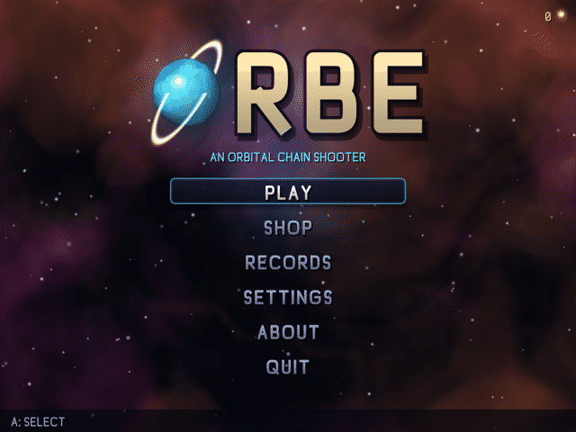
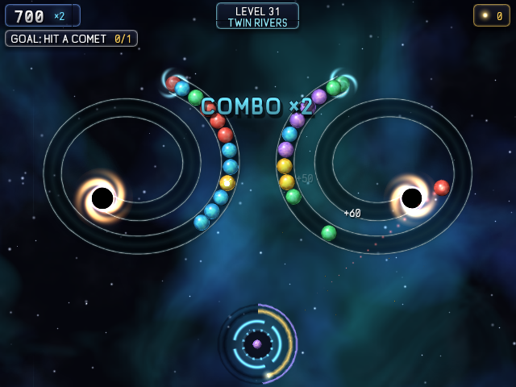

# 0RBE

**0RBE** is an original orbital chain shooter by M.A. Vélez-Guerrero ([@mandresve](mailto:mandresve@hotmail.com)), made for the Trimui Brick and Trimui Brick Pro and packaged for PortMaster by the author. Special thanks to the PortMaster team and testers for their tooling and support.

Unlike most ports, 0RBE is a small native program that generates everything at runtime. It draws all of its graphics — orbs, skies, black holes, backgrounds and its own typeface — and synthesizes all sound effects and music in real time through the system's SDL2 library.

No images, audio samples, fonts or extra libraries are bundled.

On first launch the game asks for a language: English, Español, Italiano, Français, Deutsch, Português or Nederlands. It can be changed later in Settings.

The screen adapts to **4:3, 16:9 and 1:1** displays. The playfield is the same on every device; the sky and the HUD fill the rest of the screen. Displays of other shapes get thin black bars.

## Screenshots

<p align="center">
  
  
</p>

## Downloads & Installation

0RBE comes in two packages. Both contain the same game; they differ only in how they are installed and launched.

### 1. PortMaster — `0rbe.zip`

**The standard PortMaster package** (for PortMaster on any supported handheld).

Installation:

1. Download `0rbe.zip`. Do not unzip it and zip it again: the archive must keep `0RBE.sh` and the `0rbe/` folder at its root.
2. Copy the ZIP into PortMaster's `autoinstall` folder on your device.
3. Open PortMaster; it installs the game automatically.
4. Launch 0RBE from your device's Ports menu.

Alternatively, extract the ZIP into your firmware's `ports` folder, so that it contains `0RBE.sh` and the `0rbe/` folder.

### 2. Standalone PAK — `0rbe.pak.zip`

**A tool pak for NextUI on the Trimui Brick and Brick Pro** (platform `tg5040`).

Installation:

1. Download `0rbe.pak.zip` and extract it.
2. Copy the whole `0rbe.pak` folder to `/Tools/tg5040/` on the SD card. It must look like this:
   ```
   /Tools/tg5040/0rbe.pak/launch.sh
   /Tools/tg5040/0rbe.pak/orbe
   /Tools/tg5040/0rbe.pak/LICENSE.txt
   ```
3. Launch 0RBE from **Tools**.

MinUI and NX Redux use the same `Tools/tg5040` pak layout, so the pak should work there too, but it has only been tested on NextUI.

### Which package should I use?

| Frontend / Environment | Package |
|---|---|
| PortMaster (any supported device) | `0rbe.zip` |
| NextUI (Trimui Brick / Brick Pro) | `0rbe.pak.zip` |
| MinUI, NX Redux (Trimui Brick / Brick Pro) | `0rbe.pak.zip` (untested) or `0rbe.zip` through PortMaster |

## Game Features

- **Orbital chain-shooter gameplay:** shoot orbs from the energy core into a chain rolling toward a black hole; match three or more of a color, close gaps to set off chain reactions, keep combos going and catch comets.
- **Three modes:** Journey (an endless galaxy map of deterministic levels across six sectors, with a boss every 10 levels), Endless and Daily Orbit.
- **Power-ups and mechanics:** 8 power-ups, the Nova orb, twin paths, rail cores, asteroid and frozen orbs, wormholes and boss mechanics.
- **Four difficulty curves:** Relaxed, Normal, Hard and Expert.
- **Progression:** 116 achievements, level goals, statistics, and a shop with 100 cosmetics (cores, trails, orb skins, skies and black holes) bought with stardust.
- **Procedural graphics:** orbs, backgrounds, skies, black holes and typography are all drawn by the game.
- **Real-time synthesized audio:** every sound effect and the 10 original songs are generated as you play.
- **Seven languages:** English, Español, Italiano, Français, Deutsch, Português and Nederlands.
- **Adaptive screen:** 4:3, 16:9 and 1:1 layouts with the same playfield; other display shapes are letterboxed.
- **Vibration** on devices with a rumble motor or a controller that supports it.
- **Persistent progress:** progress and settings are saved automatically.
- **Minimal dependencies:** only the system's SDL2, libm and libc.

## Controls

| Button | Action |
|---|---|
| D-Pad | Move the crosshair; navigate menus |
| Left / Right Stick | Move the crosshair (where present) |
| L1 / R1 (hold) | Move the crosshair faster |
| A / R2 | Shoot; confirm |
| B / L2 | Swap the next orb; back |
| Y | Fire the Nova orb (when ready) |
| X (hold) | Precise aim |
| Select | Toggle the aim guide on / off |
| L3 / R3 | Center the crosshair (where present) |
| Start / Menu | Pause |
| Start + Select (hold 1 second) | Exit |

Everything can be played with the D-Pad alone. Under PortMaster, your device's usual exit hotkey also works.

## Compatibility

0RBE was developed on the Trimui Brick Pro and is made for the Trimui Brick and Brick Pro.

The PortMaster package is device-agnostic: it reads controllers through PortMaster's mappings and adapts to the screen. It is being tested by the PortMaster community on other devices and firmwares; results depend on each device's architecture (AArch64 only) and its SDL2 version.

## Saves & Logs

Progress and settings are saved automatically. A corrupted save is reset, and the old file is kept as `save.txt.bak`.

| Package | Save file | Log file |
|---|---|---|
| PortMaster | `ports/0rbe/conf/save.txt` | `ports/0rbe/log.txt` |
| NextUI pak | `Orbe/save.txt` in the frontend's shared user-data folder (the log's `save:` line shows the exact path) | `/Tools/tg5040/0rbe.pak/orbe-log.txt` |

If something goes wrong, the log file is the most useful thing to share when reporting it.

## Technical Details

| Property | Description |
|---|---|
| Architecture | ARM64 (AArch64) |
| Screen | 4:3 (1024 × 768), 16:9 (1366 × 768) or 1:1 (1024 × 1024) canvas, scaled to the display |
| Graphics | Procedurally generated |
| Audio | Synthesized in real time |
| Library | SDL2 (2.0.18 or newer) |
| External assets | None |
| Source code | Closed source |

## Compile

0RBE is closed source.

The included binary (`orbe.aarch64` in the PortMaster package, `orbe` in the pak) is built by the author with the `ghcr.io/loveretro/tg5040-toolchain` Docker image (GCC 8.3, glibc 2.17).

Runtime dependencies:

- `libSDL2-2.0.so.0` (SDL 2.0.18 or newer)
- `libm`
- `libc` (glibc 2.17 or newer)

Nothing else is needed.

## Testing & Feedback

0RBE is being tested with the help of the PortMaster community.

For test reports, bug reports, compatibility feedback, suggestions or general discussion, visit the official **[0RBE Testing Thread on Discord](https://discord.com/channels/1122861252088172575/1571976260857630941)**. Please include your device, firmware and the log file.

## License & Distribution

0RBE is freeware. It may be downloaded, used, copied and redistributed unmodified, free of charge, with its licence included. The PortMaster project may package and distribute it.

The full terms are in `0rbe/licenses/LICENSE.0rbe.txt` (PortMaster package) and `0rbe.pak/LICENSE.txt` (pak).

---

**Created by M.A. Vélez-Guerrero**

[@mandresve](mailto:mandresve@hotmail.com)
